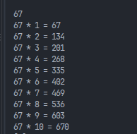

# Tabuada em C

## 1. Descrição
Este projeto é um programa simples e direto escrito em linguagem C que gera a tabuada de um número inteiro. Ele recebe como entrada um número de 0 a 1000 e imprime suas multiplicações pelos números de 1 a 10. É uma ferramenta útil para estudantes ou qualquer pessoa que queira consultar rapidamente os produtos de um número.

## 2. Demonstração
Abaixo está uma demonstração do programa em execução:


*(Observação: O programa não exibe nenhuma mensagem antes de esperar você digitar o número no terminal).*

## 3. Instalação e Pré-requisitos
O programa utiliza apenas a biblioteca padrão da linguagem C (`stdio.h`). Para rodar o código, você precisará preparar o seguinte ambiente:

* **Visual Studio Code:** Utilize a opção "File > Open Folder" para abrir a pasta do projeto[cite: 8].
* **Compilador C:** Utilize o GCC se você estiver no Windows ou Linux. Se estiver no macOS, prepare e configure o Clang[cite: 8].
* **Extensão:** Instale a extensão "C/C++ Compile Run" no VS Code[cite: 8].

## 4. Uso e Exemplos
Siga os passos abaixo para testar o programa:

1. Abra o arquivo `main.c` no VS Code e salve-o[cite: 8].
2. Execute o programa:
   * **Windows ou Linux:** Pressione `F6` ou abra a *Command Palette* (View > Command Palette) e escolha `C/C++: Compile & Run`[cite: 8].
   * **macOS:** Utilize a opção pelo menu de *Command Palette*[cite: 8].
3. Clique no terminal que foi aberto, digite um número inteiro (ex: de 0 a 1000) e aperte Enter[cite: 8].

**Exemplo de Resultado:**
Se você digitar o número `5`, o programa imprimirá 10 linhas no seguinte formato[cite: 8]:
```text
5 * 1 = 5
5 * 2 = 10
5 * 3 = 15
...
5 * 10 = 50
```

## 5. Estrutura do Projeto

Os arquivos essenciais do projeto estão organizados da seguinte forma:
  * main.c: O código-fonte do programa responsável por ler a entrada e imprimir as 10 linhas da tabuada.
  * instructions.txt: Documento de apoio original que explica a configuração do compilador e a execução.
  * README.md: Este arquivo com as instruções de apresentação.
  * LICENSE: Arquivo contendo os termos de uso do projeto.
  * assets/: Pasta que guarda os arquivos de mídia.
  * assets/demo.png: Captura de tela demonstrando o uso real do programa no terminal.

## 6. Licença

Este projeto adota a licença [MIT](LICENSE). Consulte o arquivo `LICENSE` no repositório para ler os termos completos de distribuição e cópia.

### Passo 3: Enviar as alterações para o GitHub
Como você fez mudanças nos arquivos locais (moveu a foto e editou o README), abra o terminal no VS Code e rode os 3 comandos abaixo para enviar as correções:

```bash
git add .
git commit -m "Corrige estrutura do projeto, licenca e caminho da imagem"
git push
```
